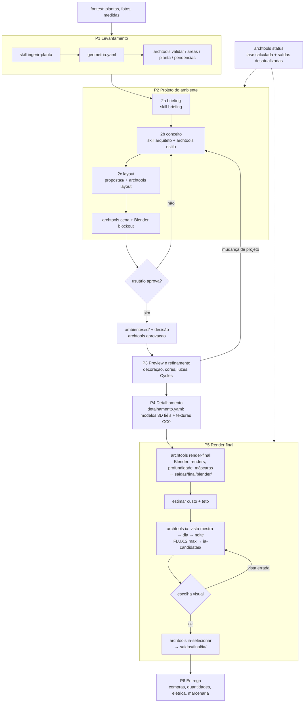

# Assistente de Arquitetura e Interiores

Ambiente de trabalho para projetos pessoais de arquitetura e design de interiores, feito para ser
operado junto com um agente (Claude Code). O agente interpreta plantas, organiza requisitos,
propõe ambientes e mantém o histórico; **todo cálculo e validação é feito pelas ferramentas
determinísticas do pacote `archtools`**, nunca "de cabeça". O Blender só monta e renderiza a cena
calculada pelo `archtools`, e a IA de imagem (FLUX.2) só dá o acabamento fotográfico, rotulado
como ilustração.

Princípios: a geometria documentada (`projetos/<nome>/geometria.yaml`) é a fonte da verdade; medidas
nunca são inventadas (cada valor é `confirmado`, `estimado` ou `desconhecido`, com fonte); decisões
do usuário ficam registradas com hash dos arquivos aprovados. Detalhes em [CLAUDE.md](CLAUDE.md).

---

## 1. Pré-requisitos

| Ferramenta | Para quê | Obrigatória? |
|---|---|---|
| [uv](https://docs.astral.sh/uv/) | instala e roda o `archtools` (Python ≥ 3.12, dependências do `tools/pyproject.toml`) | sim |
| Git | histórico do projeto | sim |
| Blender 5.3 | modelo 3D, renders, máscaras e mapas de profundidade (P2c em diante) | a partir da P2c |
| Conta na [fal.ai](https://fal.ai) com créditos | acabamento fotográfico com FLUX.2 (P5) — **pago** | só na P5 |
| Claude Code | conduz as fases pelas skills de `.claude/skills/` | recomendado |

Instalação do Blender no Windows: `winget install BlenderFoundation.Blender`. Ele fica fora do PATH;
os comandos abaixo usam o caminho completo
`C:\Program Files\Blender Foundation\Blender 5.3\blender.exe`.

O hardware de referência é um notebook sem GPU dedicada (Intel Iris Xe): Cycles roda na CPU
(~40 s por quadro 1280×720; ~8 min por quadro 1920×1080 com 192 amostras) e a IA de imagem roda na nuvem.

## 2. Instalação

```powershell
git clone https://github.com/m4c0y/architecture-helper.git
cd architecture-helper
uv sync --project tools
uv run --project tools pytest tools/tests -q
```

Todos os comandos são executados **a partir da raiz do repositório**.

Opcional — texturas CC0 (imagens ficam fora do git; o script baixa de novo):

```powershell
uv run --project tools python -I catalogo/texturas/baixar.py
```

Sem elas, o Blender usa as texturas procedurais do `archtools`.

## 3. Variáveis de ambiente e chaves

| Variável | Usada em | Obrigatória? | Alternativa |
|---|---|---|---|
| `FAL_KEY` | `archtools ia` (P5, FLUX.2 na fal.ai) | **Opcional.** Só é necessária uma chave da fal para rodar a P5; a variável é uma das duas formas de informá-la | arquivo `~/.archtools/fal.key` (só a chave, uma linha) |
| `GEMINI_API_KEY` | `archtools.ia` (biblioteca do Gemini, testado e descartado; nenhum comando da CLI usa) | Opcional — não é necessária no fluxo atual | arquivo `~/.archtools/gemini.key` |

Nenhuma outra variável é necessária: P1 a P4 e o render do Blender rodam sem chave nem internet
(exceto o download opcional de texturas). A variável tem prioridade sobre o arquivo.

```powershell
# opção A: arquivo (recomendado; fica fora do repositório)
New-Item -ItemType Directory -Force "$HOME\.archtools" | Out-Null
Set-Content -Encoding ascii "$HOME\.archtools\fal.key" "<sua-chave-da-fal>"

# opção B: variável só da sessão atual
$env:FAL_KEY = "<sua-chave-da-fal>"
```

Nunca coloque chaves no repositório, em arquivos do projeto ou no chat.

## 4. Fluxo



A fase de cada ambiente é **calculada** por `archtools status` a partir dos arquivos que existem
(não é escrita à mão). Mudou uma medida → volta para P1; mudou uma decisão de projeto → volta para P2.

## 5. Fases

### P1 — Levantamento
**O que se faz:** transformar plantas, croquis, fotos e medições de trena na geometria do imóvel:
ambientes (polígono da face interna das paredes, em mm), aberturas, pé-direito, pontos fixos. Cada
valor ganha status (`confirmado` / `estimado` / `desconhecido`) e fonte.

**Ferramentas:** skill `ingerir-planta`; scripts de medição em `medicoes/`; skill `validar-projeto`.

```powershell
uv run --project tools archtools validar projetos/<p>
uv run --project tools archtools areas projetos/<p>
uv run --project tools archtools planta projetos/<p>
uv run --project tools archtools pendencias projetos/<p>
```

**Saída:** `geometria.yaml` (fonte da verdade), `saidas/planta.png` e `.svg`, quadro de áreas e
`pendencias.md` (o que ainda é desconhecido ou estimado).

### P2 — Projeto do ambiente
**2a Briefing.** Entrevista sobre uso, rotina, quem usa, itens existentes, gostos, restrições e
prioridades. Ferramenta: skill `briefing`. Saída: `ambientes/<id>/briefing.md`, linhas novas em
`requisitos.md` e produtos com medidas em `catalogo/produtos/`.

**2b Conceito.** Estilo do ambiente com personas fictícias de arquitetos (principal + acentos):
cores por superfície e item, materiais, luzes. Ferramentas: skill `arquiteto`, skill `referencia`
(imagens de inspiração e paleta por script) e:

```powershell
uv run --project tools archtools estilo projetos/<p> --estilo <proposta>/estilo.yaml --ambiente <id>
uv run --project tools archtools paleta <imagem> --arquiteto <id> --gravar
uv run --project tools archtools referencias arquitetos
```

Saída: `propostas/<ambiente>-<nome>/conceito.yaml` e `LEIA-ME.md`.

**2c Layout.** O que vai onde, com folgas de circulação validadas, e o blockout 3D.

```powershell
uv run --project tools archtools layout projetos/<p> --layout projetos/<p>/propostas/<x>/layout.yaml --recorte <id>
uv run --project tools archtools cena projetos/<p> --layout projetos/<p>/propostas/<x>/layout.yaml --cameras <id>
& "C:\Program Files\Blender Foundation\Blender 5.3\blender.exe" --background --python blender/construir_cena.py -- `
    projetos/<p>/saidas/cena.json projetos/<p>/saidas/3d --cameras <id>-porta --res 1280x720 --motor eevee
```

Saída: `layout.yaml` da proposta (0 erros no `archtools layout`), `planta-layout.png`, `cena.json`
e renders de rascunho em `saidas/3d/`.

**Aprovação.** O usuário aprova a proposta → `conceito.yaml` e `layout.yaml` são copiados para
`ambientes/<id>/` e a decisão é registrada (skill `registrar-decisao`) com o cabeçalho de hash:

```powershell
uv run --project tools archtools aprovacao projetos/<p> --arquivos ambientes/<id>/layout.yaml ambientes/<id>/conceito.yaml
```

Saída: `decisoes/NNNN-titulo.md`.

### P3 — Preview e refinamento
**O que se faz:** o design completo renderizado — decoração (`categoria: decor`: tapete, quadros,
livros, plantas, cortinas; `sobre:` apoia um item em outro e o `archtools` calcula a altura),
texturas procedurais, luzes de dia e de noite, câmeras fixas do ambiente (`cameras.yaml`) para
comparar propostas sempre do mesmo ponto. Cada mudança de projeto volta para P2 e gera nova decisão.

**Ferramentas:** `archtools layout`, `archtools cena`, Blender (`--motor cycles --periodo ambos`).

**Saída:** renders de dia e de noite em `saidas/3d/` (com `manifest.json`), decisões atualizadas.

### P4 — Detalhamento
**O que se faz:** mais fidelidade sem mudar nenhuma decisão: cada produto visível ganha um modelo 3D
fiel (silhueta, encosto, braços, pés, almofadas, cores por peça) e os materiais ganham texturas
de imagem CC0. A caixa do catálogo não muda, então o layout continua válido. **Todo item com
`produto:` visível nas câmeras precisa de `modelo` detalhado**: é por ele que a forma do móvel
chega à IA na P5 (fotos de produto não são enviadas à IA; servem só para modelar).

**Ferramentas:** `ambientes/<id>/detalhamento.yaml`, modelos paramétricos de
`tools/src/archtools/modelos.py`, texturas de `catalogo/texturas/`, `archtools cena`, Blender.

**Saída:** `cena.json` com os modelos detalhados e renders de conferência.

### P5 — Render final
**O que se faz:** as imagens definitivas do ambiente, em duas camadas guardadas separadamente:

1. **Blender (referência de medidas e cores).** Configuração em `ambientes/<id>/render_final.yaml`
   (câmeras, períodos, motor, resolução, amostras, pasta de saída e bloco `ia:`). O comando abaixo
   imprime as três chamadas do Blender — render Cycles, mapa de profundidade e máscaras — já
   apontando para `saidas/final/blender/`:

   ```powershell
   uv run --project tools archtools render-final projetos/<p> --ambiente <id>
   ```

2. **Acabamento fotográfico com IA (ilustrativo, pago).** FLUX.2 [max] edit
   (`fal-ai/flux-2-max/edit`). Cada vista recebe o render, o mapa de profundidade exato, o texto
   gerado das máscaras (onde está cada parede e objeto) e as cores fixas (`ia.fixas`). A **vista
   mestra** (`ia.mestra`, ex.: `porta-dia`) é gerada primeiro; as outras vistas de dia recebem a
   mestra como referência de aparência e as de noite recebem a imagem de dia da mesma câmera.
   Sementes `[21, 7]`: a segunda só roda se a aderência da primeira ficar abaixo de 0,85.

   **Custo (fal, nov/2026):** ≈ US$ 0,16 a mestra e ≈ US$ 0,22 por vista e semente (as imagens
   enviadas também são cobradas). Oito vistas ≈ US$ 1,70 a 3,40. Estime e defina um teto antes de rodar.

   ```powershell
   uv run --project tools archtools ia projetos/<p> --ambiente <id>
   uv run --project tools archtools ia projetos/<p> --ambiente <id> --vistas <id>-mesa-noite   # refazer uma vista
   uv run --project tools archtools ia-selecionar projetos/<p> --ambiente <id> --escolha <vista>=<arquivo> --limpar
   ```

   A nota de aderência só mede contornos e não percebe móvel inventado ou fora do lugar: a escolha
   final é visual, comparando cada candidata com o render.

**Ferramentas:** skill `render-final`, Blender (Cycles), fal.ai (FLUX.2 [max]), `archtools`
(`render-final`, `ia`, `ia-selecionar`).

**Saída:**

```
saidas/final/
  blender/   renders <id>-<câmera>-<período>.png, mascaras/, profundidade/, modelo.blend, manifest.json
  ia/        <id>-<câmera>-<período>.png escolhidas (selo "ILUSTRATIVA (IA)") + selecao.json
             (origem, semente, aderência, referência usada, quem escolheu, custo estimado)
```

A P5 termina quando o usuário aprova as imagens (decisão registrada).

### P6 — Entrega
**O que se faz:** lista de compras, quantidades, pontos elétricos e detalhes de marcenaria a partir
do que foi aprovado. Ainda sem artefato automatizado no `archtools`.

## 6. Acompanhamento contínuo

```powershell
uv run --project tools archtools status projetos/<p>
```

Mostra a fase calculada de cada ambiente, arquivos aprovados alterados sem decisão e saídas
desatualizadas (cada pasta de `saidas/` tem `manifest.json` com as entradas de que veio).

## 7. Estrutura do repositório

```
tools/                 pacote Python archtools (CLI + testes)
blender/               construir_cena.py: lê cena.json e monta/renderiza no Blender
arquitetos/            personas de estilo fictícias + referências + tags.yaml
catalogo/              produtos genéricos e texturas CC0 (texturas.yaml + baixar.py)
docs/                  proposta de arquitetura (fases, roteiro)
.claude/skills/        procedimentos do agente: ingerir-planta, validar-projeto, registrar-decisao,
                       briefing, arquiteto, referencia, render-final
projetos/<nome>/       geometria.yaml, ambientes/, decisoes/, propostas/, saidas/ ...
```

`saidas/` de qualquer projeto fica fora do git (é regenerável). Os projetos com dados pessoais do
imóvel (`projetos/apartamento/` e `projetos/apartamento-reforma/`) estão inteiros no `.gitignore`,
porque o repositório é público; projetos novos com dados pessoais devem ser acrescentados lá.
